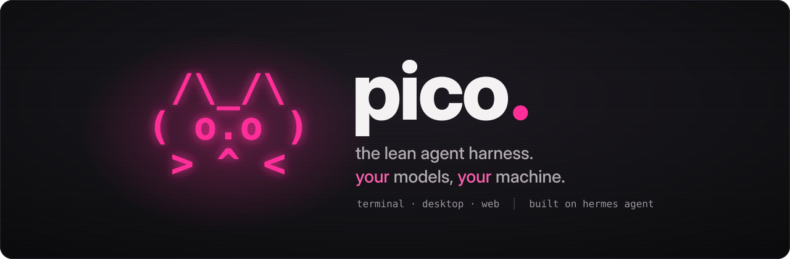
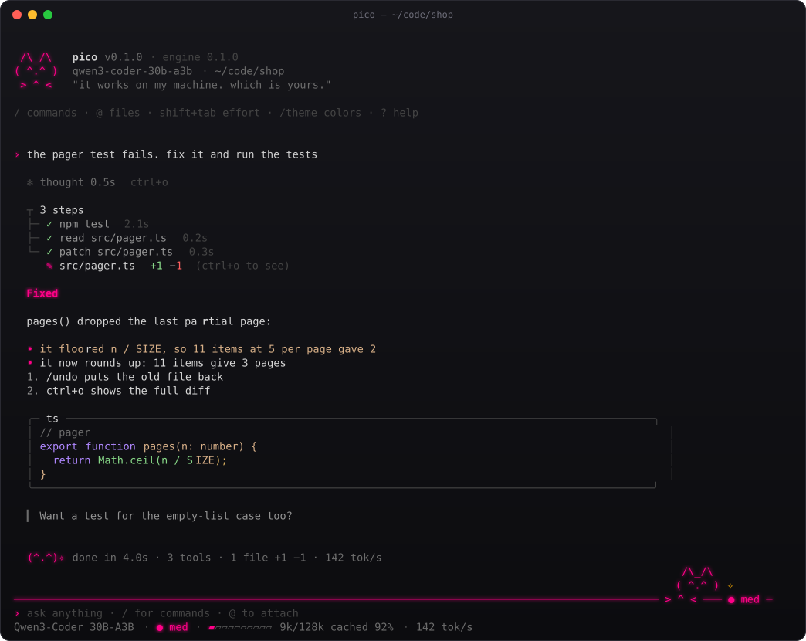
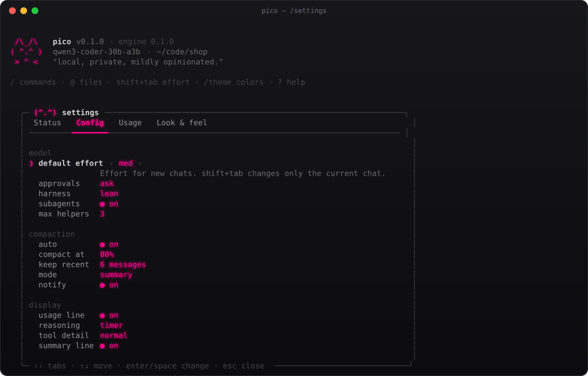
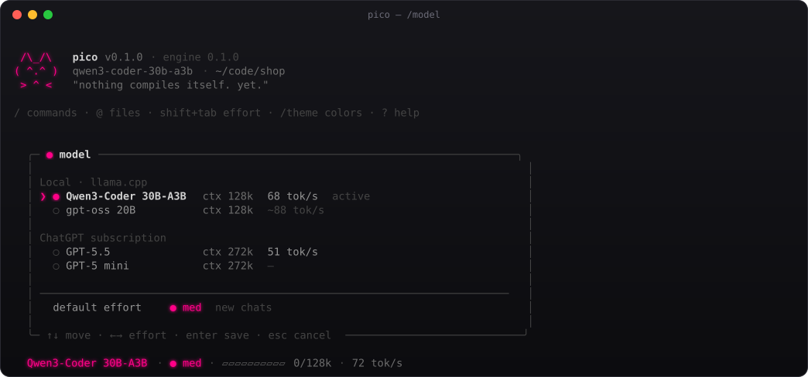
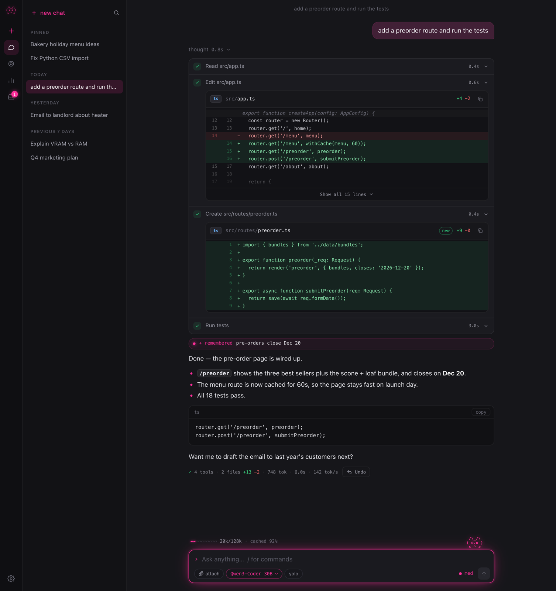
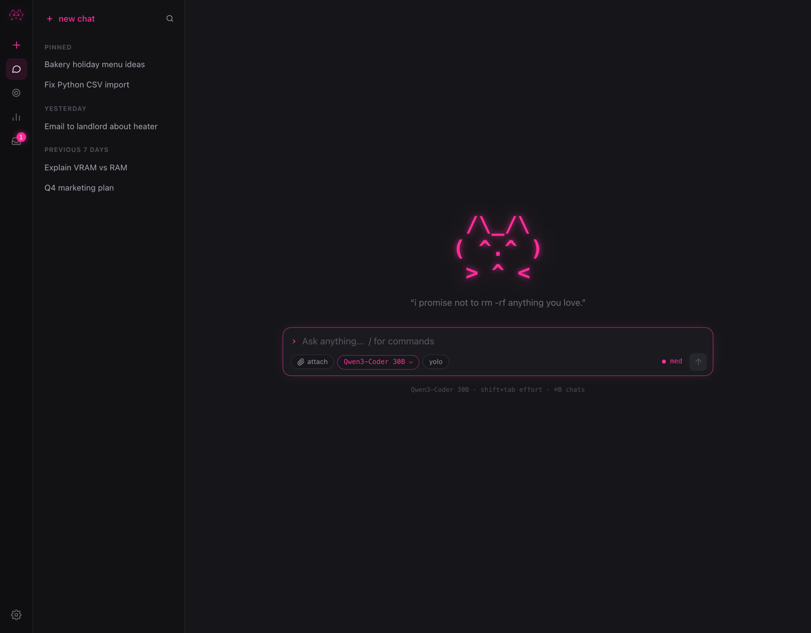
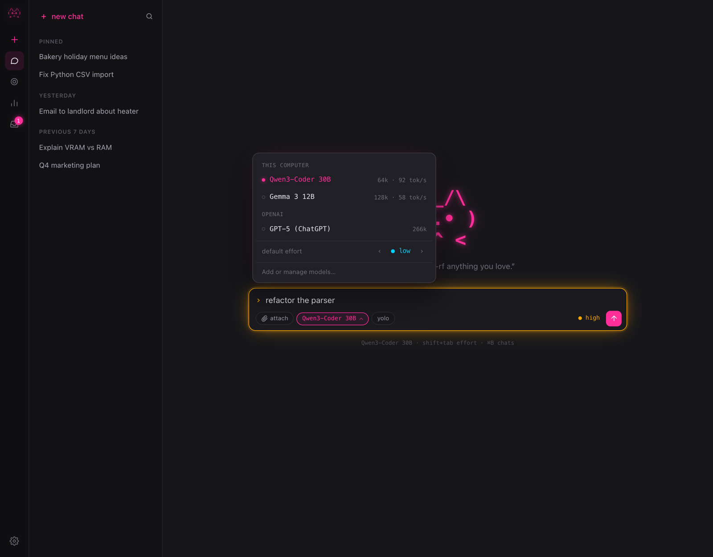
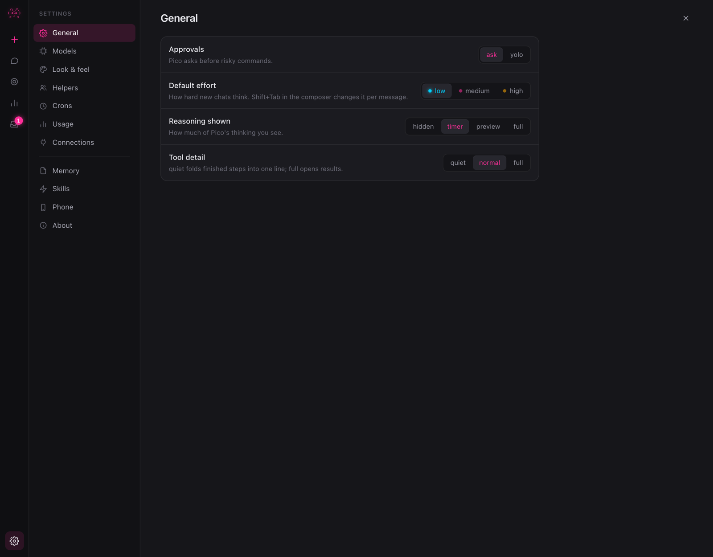
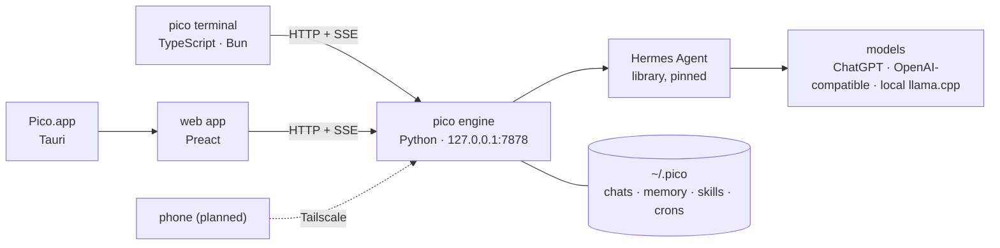

<div align="center">



<p>
  <a href="LICENSE"></a>
  
  <a href="docs/EVAL.md"></a>
  <a href="docs/LEAN.md"></a>
  <a href="https://github.com/NousResearch/hermes-agent"></a>
</p>

**An agent for coding and everyday work that runs on the models you choose: your ChatGPT plan, any OpenAI-compatible API, or a model on your own GPU.**<br>
Terminal, desktop and web on one local engine. It matches stock Hermes on pass rate while using under a third of the prompt.

</div>

```sh
# macOS · Linux
curl -fsSL https://raw.githubusercontent.com/Picom-code/pico/main/installer/install.sh | sh
```

```powershell
# Windows (PowerShell)
irm https://raw.githubusercontent.com/Picom-code/pico/main/installer/install.ps1 | iex
```

Then run `pico`. The first launch walks you through choosing a model. Updates are offered, never applied automatically. Installer details are in [installer/README.md](installer/README.md).

<p align="center">
  
</p>

## Why pico

- **Lean by default.** It passes the same 60/60 eval as stock Hermes with **72% fewer prompt tokens** per task and **34% less wall time**. The first turn sends about 2.0K tokens instead of about 9.1K.
- **A real agent, not a chat box.** Minimal harnesses like Pi drop features that pico keeps from Hermes: memory, skills, crons, subagents and background replies.
- **Your models, your machine.** Sign in with ChatGPT, paste any OpenAI-compatible endpoint, or let pico scan your hardware and pick a local model that fits. Your data stays in `~/.pico`.
- **Pleasant to use.** You can steer mid-reply, roll back with `/undo` (file checkpoints included), and accept tab completions from ghost text. The terminal UI was tuned frame by frame. You get the cat, not emoji fireworks.

## Benchmarks

The suite has 30 tasks (coding, ops, everyday tasks, memory, skills, long context), each run twice, on `deepseek-v4.1-flash`. Full method: [docs/EVAL.md](docs/EVAL.md) · [docs/LEAN.md](docs/LEAN.md).

| metric | stock Hermes | **pico lean** | Δ |
|---|---:|---:|---:|
| pass rate | 60 / 60 | **60 / 60** | ±0 |
| prompt tokens / task (median) | 57.9K | **16.4K** | **−72%** |
| wall time / task (median) | 43.5s | **28.6s** | **−34%** |
| first-turn prompt | ~9.1K | **~2.0K** | **−78%** |

Lean also holds its pass rate as filler context grows from +0 to +32K tokens, with no cliff ([context curve](eval/results/context-curve.md)).

## Features

<table>
<tr><td width="50%" valign="top">

**In the chat**
- **Steer:** press `enter` mid-reply and your message lands while the agent keeps working
- `/plan` drafts a plan, then waits for your go
- `/goal` pins a goal banner and checklist
- `/undo` rolls back the last turn, files included
- `/yolo` runs commands without asking (toggle)
- `@file` attachments, tab completion with ghost text
- Live tool tree, real diffs, `ctrl+o` to expand

</td><td width="50%" valign="top">

**Around the chat**
- `/loop 10m "check CI"` repeats on a timer or until the task is done
- `/cron` takes plain English and delivers results to `/inbox`
- `/usage` shows tokens, time and tok/s per model over 30 days
- `/model` picker with default effort, `shift+tab` per chat
- `/lean` slims your profile and shows the measured speedup
- Auto-compaction (summary or trim), <code>/compact&nbsp;[focus]</code>
- Subagents panel: parallel helpers, each with its own model and budget

</td></tr>
<tr><td valign="top">

**Make it yours**
- `/settings` tabs in the style of Claude Code: Status · Config · Usage · Look & feel
- 6 accents, 8 spinners, 4 reply styles, ASCII fallback
- Verbosity from quiet to full, set separately for reasoning and tools

</td><td valign="top">

**Setup and other surfaces**
- ChatGPT login, or any OpenAI-compatible API (presets plus a live test)
- A local hardware scan picks a model that fits your GPU or Mac
- Desktop app (Tauri, 4.3 MB) and a web app on the same engine
- Phone pairing over Tailscale (iOS remote planned)

</td></tr>
</table>

<table>
<tr>
<td align="center" width="50%" valign="top"><br><sub><code>/settings</code></sub></td>
<td align="center" width="50%" valign="top"><br><sub><code>/model</code></sub></td>
</tr>
</table>

<details>
<summary><b>Keys and commands cheat sheet</b></summary>

| key | does |
|---|---|
| `enter` / `shift+enter` | send / new line (send while busy = steer) |
| `esc` | stop the current reply |
| `shift+tab` | cycle effort for this chat (low · med · high) |
| `ctrl+o` | expand or collapse thinking and tool output |
| `tab` | accept the ghost-text completion |
| `@` | attach a file (fuzzy search) |
| `ctrl+l` | redraw |
| `ctrl+u` / `ctrl+k` / `ctrl+w` | kill line / to end / word |

| command | does |
|---|---|
| `/model [id]` | switch model, set default effort |
| `/setup` · `/login` | ChatGPT, any API, or local |
| `/new` · `/resume` · `/sessions` · `/search` | chats |
| `/plan <task>` · `/goal [text]` | plan first / pin a goal |
| `/loop <5m\|until-done> …` · `/cron` · `/inbox` | recurring and scheduled work |
| `/undo` · `/yolo [on\|off]` | checkpoints / approvals |
| `/compact [focus]` · `/lean` · `/usage` | context and cost |
| `/agents` · `/memory` · `/skills` · `/connect` | helpers, memory, skills, apps |
| `/settings` · `/theme` · `/verbose` | look and feel |
| `/copy` · `/clear` · `/help` · `/quit` | the rest |

Scripting: `pico -p "prompt"` prints one answer and exits (`--json` emits events). Examples: `git diff | pico -p "review this"`, `pico doctor`.

</details>

## Desktop

<p align="center">
  
</p>
<table>
<tr>
<td align="center" width="33%"><br><sub>new chat</sub></td>
<td align="center" width="33%"><br><sub>model picker</sub></td>
<td align="center" width="33%"><br><sub>settings</sub></td>
</tr>
</table>

## How it fits together



| dir | what |
|---|---|
| [`engine/`](engine) | Python engine: sessions, lean harness, compaction, crons, hardware scan, setup. API reference: [docs/API.md](docs/API.md) |
| [`cli/`](cli) | Terminal app (TypeScript, Bun single binary) |
| [`web/`](web) · [`desktop/`](desktop) | Preact web app and the Tauri shell around it |
| [`installer/`](installer) | `install.sh` / `install.ps1`: uv-managed Python, pinned Hermes, launcher |
| [`eval/`](eval) | Harness eval suite and context-curve runner |
| [`recipes/`](recipes) | Local model catalog used by the hardware scan |

## Roadmap

- [x] Engine on Hermes Agent, lean harness, eval suite
- [x] Terminal app: steer, undo, plan, goal, loop, cron, usage, settings
- [x] Web app and desktop app (Tauri)
- [x] One-line installer (macOS · Linux · Windows)
- [ ] Signed desktop builds and prebuilt binaries for every platform
- [ ] iOS remote over Tailscale
- [ ] Local voice, image and video
- [ ] Catalog agent that offers faster local models as they ship

## Contributing

PRs are welcome. [CONTRIBUTING.md](CONTRIBUTING.md) covers dev setup, tests and the eval. Report security issues by following [SECURITY.md](SECURITY.md).

## Credits

pico is built on **[Hermes Agent](https://github.com/NousResearch/hermes-agent)** by [Nous Research](https://nousresearch.com) (MIT). The agent loop, tools, memory and skills come from Hermes. The lean harness, engine, apps and installer were written for pico.

## License

[MIT](LICENSE) © 2026 Patrick Moorhead

<p align="center"><sub><code>( ^.^ )</code> tests first, then snacks.</sub></p>
